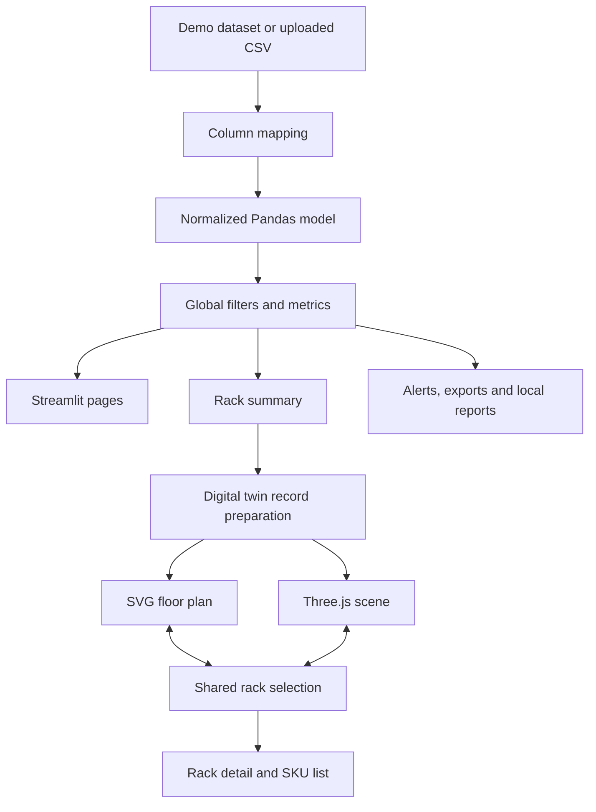

# Architecture

The application runs locally as a Streamlit process. Pandas owns data normalization, filtering and KPI calculations. Plotly renders analytical charts. The digital-twin component receives the filtered rack and inventory records prepared by Python.

## Components

- `app.py` — demo data generation, CSV mapping, filter state, calculations, navigation and page rendering.
- `digital_twin.py` — converts rack and inventory frames to JSON-safe records and loads the view template.
- `static/digital_twin.html` — component structure and display placeholders.
- `static/digital_twin.css` — component layout and styling.
- `static/floorplan.js` — SVG rack layout, search, selection and detail panel.
- `static/three_scene.js` — Three.js warehouse geometry, camera controls and local forklift simulation.

The 2D and 3D views use the same selected rack ID within the embedded component. Selecting a rack in either view updates the detail panel and the other view.

## Data flow

1. Demo data is generated with a fixed NumPy seed, or a user uploads a CSV.
2. CSV columns are mapped to the standard inventory fields.
3. The normalized inventory frame receives derived value, age and stock-status fields where source columns support them.
4. Global filters are applied before calculating page metrics and rack summaries.
5. The digital twin receives only the current filtered rack and SKU records.

The warehouse layout and equipment are visual simulations. The database schema and Power BI files are reference assets, not active integrations.
